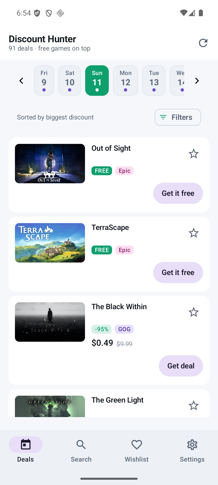
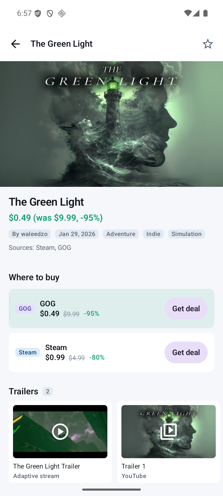
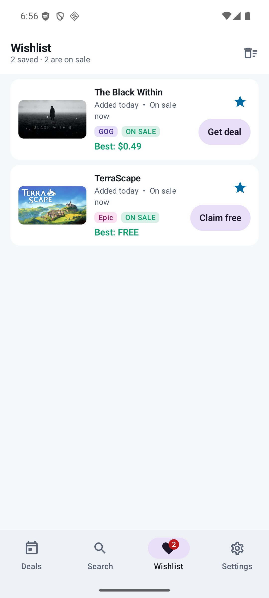
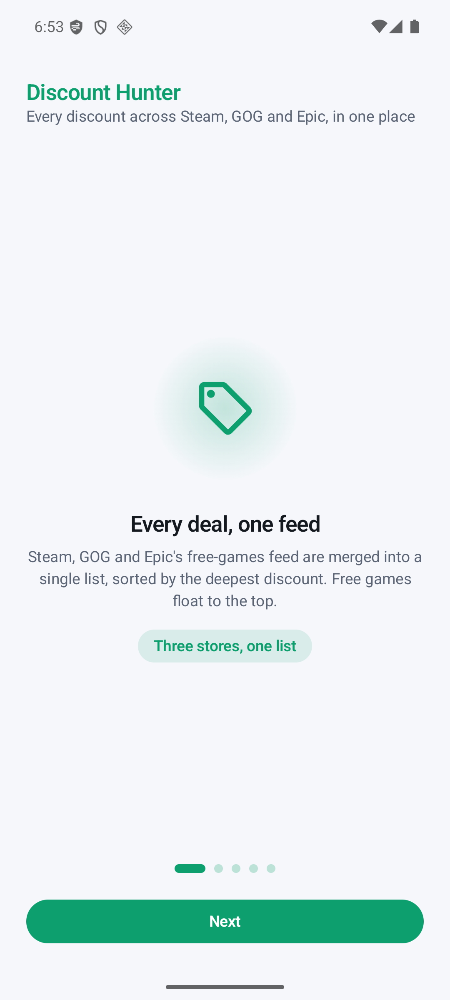
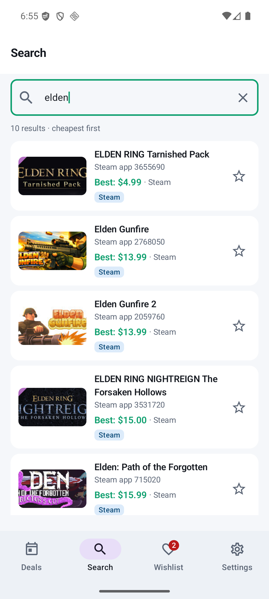
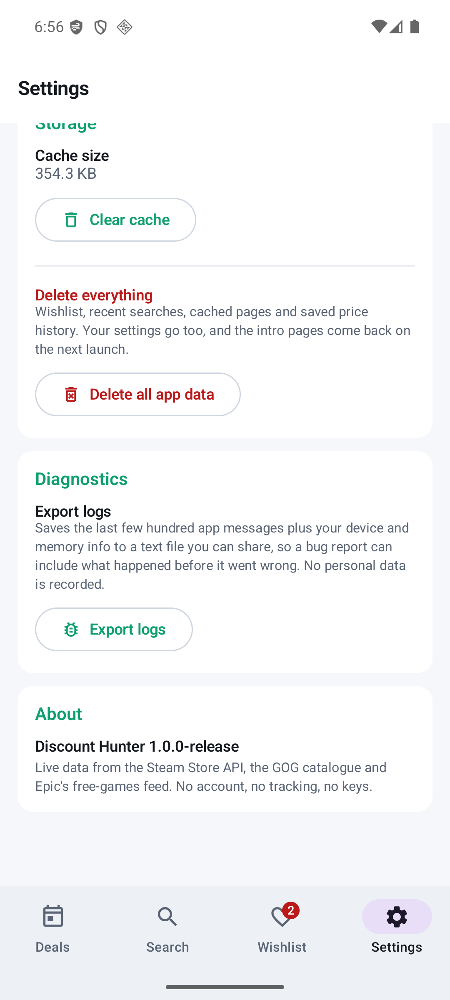

# Discount Hunter

**Every game discount from Steam, GOG and Epic in one Android feed — with an honest price, a wishlist
that follows you around, and a detail page for every game.**

<p align="center">
  
  
  
</p>

---

## What it does

Discount Hunter is a native Android app (Kotlin + Jetpack Compose) that pulls live discounts from
**Steam, GOG and the Epic Games Store**, merges them into a single daily feed, and lets you save
games to watch their prices.

| | |
|---|---|
| 🛒 **Daily deal feed** | Every discount across all three stores, sorted, filterable, with a seven-day strip for browsing past and upcoming days |
| 🔎 **Cross-store search** | Search all three stores at once and get one deduplicated result per game, not one per store |
| 💶 **An honest price** | Prices are quoted in the currency the store actually used, and genuinely converted when they differ — never relabelled |
| ⭐ **Wishlist** | Save any game from the feed, search results or a detail page. Saved games rise to the top everywhere they appear |
| 🔔 **Deal alerts** | A notification when a saved game goes on sale, and when a game becomes free — with the name, the new price and the discount. Checked in the background, including when the app is closed |
| 🖼️ **Rich detail pages** | Hero art, screenshots, trailers, system requirements, genres, "Where to buy" comparing every store that has the game |
| 📈 **Price history** | A chart of prices **this device** recorded, with deep links to external databases |
| 🎨 **Material You** | Follows your system light/dark theme, edge-to-edge, with hand-tuned motion throughout |
| 🔒 **Private by design** | No account, no tracking, no analytics, no API keys. Everything is cached on-device |

<p align="center">
  
  
  
</p>

## What is new in 1.1.0

**Deal alerts.** The app now tells you when a game you saved goes on sale, and when a game becomes
free to keep — with the name, the new price and the discount — and it does so **with the app
closed**. See [CHANGELOG.md](CHANGELOG.md) for the full list, including the five bugs this release
fixes along the way.
## Download

<p align="center">
  <a href="https://github.com/JuggyBob/DiscountHunterAndroid/releases/latest">
    
  </a>
  
  
</p>

**Grab it from the [Releases page](https://github.com/JuggyBob/DiscountHunterAndroid/releases/latest)
→ Assets.** That is the only place a phone can actually download it from — GitHub serves release
assets as real downloads, whereas a binary committed to a repository is fetched through the repo's
raw file path, which a phone browser will either refuse or save with the wrong name.

Every release contains:

- **`discount-hunter-<version>.apk`** — the optimised release build, signed with the release key
- **Source code (zip)** and **(tar.gz)** — generated by GitHub from the tagged commit

The APK is signed with the project's release key, so it installs **over** any earlier version
without an uninstall. If your device warns about an unknown source, allow your file manager to
install apps — that is the one prompt Android asks for:

1. Tap the downloaded `.apk`.
2. Android says it is from an unknown source → **Settings** → allow your file manager to install apps.
3. Go back and tap the APK again.

To withdraw that permission afterwards: **Settings → Apps → (your file manager) → Permissions →
Install unknown apps → Deny**.

Requires **Android 7.0 (API 24)** or newer. Portrait orientation only.

### Build it yourself

```bash
git clone https://github.com/JuggyBob/DiscountHunterAndroid.git
cd DiscountHunterAndroid
echo "sdk.dir=/path/to/Android/sdk" > local.properties
./gradlew assembleRelease
```

## Build from source

Discount Hunter is a standard Gradle project — no special tooling beyond the Android SDK.

**Requirements**

- JDK 17+ (tested on JDK 25)
- Android SDK with **API 36** installed
- The Gradle wrapper handles Gradle itself — nothing to install

**Quick start**

```bash
# Point the build at your SDK (or set ANDROID_HOME / ANDROID_SDK_ROOT)
echo "sdk.dir=/path/to/Android/sdk" > local.properties

# Build a debug APK
./gradlew assembleDebug

# Run the unit tests
./gradlew testDebugUnitTest

# Build the optimised release APK
./gradlew assembleRelease
```

The debug variant installs as `com.discounthunter.android.debug` so it sits alongside a release
install without one overwriting the other.

**Toolchain**

| | |
|---|---|
| Language | Kotlin 2.2.10 |
| UI | Jetpack Compose (BOM 2024.09.00), Material 3 |
| Gradle | 9.3.1 (via wrapper) |
| Android Gradle Plugin | 9.1.1 |
| Min / target SDK | 24 (Android 7.0) / 36 |
| JVM target | 11 |

## How it is built

```
app/src/main/java/com/discounthunter/android/
├── core/          # Pure Kotlin: models, text matching, price formatting, FX
├── data/          # Networking, caching and parsing — one package per store
│   ├── steam/     # Steam Store API
│   ├── gog/       # GOG catalogue
│   ├── epic/      # Epic free-games feed (GraphQL)
│   ├── cache/     # Region-scoped snapshots, payload cache
│   └── repo/      # Repositories merging the stores together
├── alerts/        # Background deal alerts: detection, scheduling, notification
├── diagnostics/   # In-app log + crash capture used by the export button
├── di/            # AppContainer — the hand-rolled dependency graph
└── ui/            # Compose screens, one package per screen, plus shared components
```

There is no dependency-injection framework and no database — DataStore for preferences, files for
the price-history snapshots, and a small hand-wired container for object lifetimes. The whole app is
~80 Kotlin source files.

Some decisions worth knowing about, all explained at length in
[`docs/ENGINEERING.md`](docs/ENGINEERING.md) and [`DEV_NOTES.md`](DEV_NOTES.md):

- **Store-native ids, never titles.** A game is identified by its store id (`s1:1245620`) wherever
  one exists, and by a normalised title only as a fallback. Titles are never used as cache keys.
- **Prices are converted, not relabelled.** Steam and Epic re-quote per region; GOG publishes in
  dollars regardless. The app converts using the ECB's daily reference rates and marks the result
  with `~`, so a converted price is never mistaken for a quoted one.
- **Media belongs to a verified identity.** A game's screenshots and trailers are only ever shown
  when the store positively confirmed the id, so one game can never display another's media.
- **The background check runs on two mechanisms.** An `AlarmManager` alarm is punctual and
  Doze-aware; a WorkManager periodic job is guaranteed and survives a reboot. Both end up running
  the same idempotent check, so overlapping triggers cannot double-notify. Only *changes* are
  announced — a game that is still discounted tomorrow is not announced again.

## Testing

```bash
./gradlew testDebugUnitTest      # 355 unit tests across 27 suites
```

The suite covers the things that are easy to get quietly wrong: cross-store identity and media
ownership, currency conversion and price ranking, cache invalidation and region scoping, filtering
and sorting, network failure and rate limiting, and JSON/HTML parsing edge cases.

## Reporting bugs

Please read [`CONTRIBUTING.md`](CONTRIBUTING.md) — it explains how to file a useful report, and the
app has a built-in **Diagnostics → Export logs** button that attaches everything a maintainer needs
(the last few hundred log lines plus your device and memory info) to a bug report.

## Contributing

Pull requests are welcome. See [`CONTRIBUTING.md`](CONTRIBUTING.md) for the coding standards, branch
naming conventions, and how to submit a change. By participating you agree to license your work
under the [Apache 2.0](LICENSE) license.

## License

[Apache License 2.0](LICENSE) — use it, change it, ship it.

This project is not affiliated with, endorsed by, or connected to Valve, GOG.com, or Epic Games.
Game titles, cover art and store data belong to their respective owners; the app displays them only
as returned by each store's public API.
